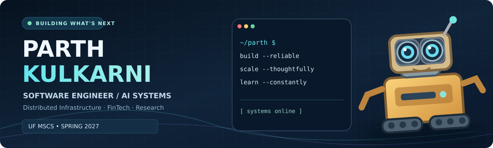

<div align="center">



<br/>

<h1>Hey, I'm Parth Kulkarni 👋</h1>

<h3>Software Engineer • AI Systems • Distributed Infrastructure</h3>

<p><strong>Incoming M.S. Computer Science @ University of Florida | Spring 2027</strong></p>

<p><em>I build AI-enabled products and the backend systems that make them reliable, useful, and scalable.</em></p>

<a href="https://github.com/HOWITTZER99?tab=repositories"></a>
<a href="mailto:parthkulkarni1887@gmail.com"></a>
<a href="https://www.cise.ufl.edu/"></a>

</div>

---

## 🧠 The engineer behind the robot

I'm a **software engineer** with hands-on experience across **Python backends, cloud services, microservices, applied machine learning, and AI agents**. My focus is the engineering *behind* intelligent products: orchestration, performance, interfaces, reliability, data, and systems design.

I care about the point where an exciting prototype becomes something people can actually depend on.

- 🎓 **Next chapter:** University of Florida, **M.S. in Computer Science**, Spring 2027
- 🔬 **Research interests:** distributed AI, efficient/edge learning, scalable inference, and AI systems
- 🏦 **Industries I want to build for:** fintech, AI infrastructure, developer tools, and technically ambitious startups
- 🎯 **Career interests:** AI/ML infrastructure, backend/systems and research-engineering internships

### Selected engineering experience

| Area | What I've worked on |
|:--|:--|
| 🤖 **AI products** | Built a voice-enabled **AI interview agent** that supported **500+ employee evaluations**, connecting LLM workflows with backend APIs and analytics. |
| ⚡ **Backend performance** | Contributed to an API/backend improvement associated with a reported **55% throughput gain**. |
| ☁️ **Cloud and services** | Worked with Python-based services, REST APIs, Redis, MySQL, Docker, and AWS in production-oriented engineering workflows. |
| 🧪 **Applied ML** | Worked on computer vision, recommendation, NLP, and data-analysis projects; **Smart India Hackathon finalist**. |

<sub>Professional results are summarized from my résumé. Employer code is not public; these outcomes are not presented as independently reproduced GitHub benchmarks.</sub>

---

## 🛠️ My toolkit

| Domain | Tools and technologies |
|:--|:--|
| **Languages** | Python, SQL, JavaScript |
| **Backend & APIs** | FastAPI, Django, Flask, REST APIs, microservices |
| **AI / ML** | PyTorch, TensorFlow, Hugging Face Transformers, LLM APIs, NLP, OpenCV |
| **Data & storage** | Redis, MySQL, MongoDB, Pandas |
| **Cloud & deployment** | AWS, Docker, Linux, Git, CI/CD |
| **Deepening now** | Distributed systems, model serving, Kubernetes, efficient inference, federated learning, observability |

> **Design preference:** Fewer magic demos. More architecture diagrams, tests, repeatable benchmarks, and real users.

---

## 🚀 Public work

<table>
<tr>
<td width="50%" valign="top">

<h3><a href="https://github.com/HOWITTZER99/neo_screener">📈 Neo Screener</a></h3>
<p><strong>Fintech · NLP · Backend</strong></p>
<p>A prototype financial analytics dashboard exploring market-data ingestion, FinBERT sentiment, historical value-at-risk, and portfolio calculations.</p>
<p><strong>Stack:</strong> Python, FastAPI, Streamlit, Transformers</p>
<p><strong>Status:</strong> Experimental prototype; known limitations and next steps are documented in the repo.</p>

</td>
<td width="50%" valign="top">

<h3><a href="https://github.com/HOWITTZER99/Movie--Recommendation">🎬 Movie Recommendation</a></h3>
<p><strong>Recommendations · Applied ML</strong></p>
<p>An earlier recommendation-system project focused on learning recommendation methods and translating ML concepts into an application.</p>
<p><strong>Stack:</strong> Python, recommendation algorithms</p>
<p><strong>Status:</strong> Learning-stage work, not a scaled production service.</p>

</td>
</tr>
</table>

<div align="center">

<p><strong><a href="https://github.com/HOWITTZER99?tab=repositories">Explore all repositories →</a></strong></p>

</div>

---

## 🧬 Research and ambitious builds

I'm interested in systems that combine **research depth with tangible product utility**. These are **project concepts I'm exploring**, not completed research appointments or deployed products.

| Direction | Problem I want to investigate |
|:--|:--|
| **EdgeMind** | Resource-aware federated AI, device heterogeneity, communication efficiency, and privacy trade-offs |
| **GatorPilot** | A researcher-focused assistant for Slurm job debugging, resource estimation, and reproducible compute workflows |
| **Inference systems lab** | Measure latency, throughput, batching, memory, and cost trade-offs in AI model serving |
| **Fintech infrastructure** | Traceable risk-data pipelines, reliable analytics, and observability under load |

**At UF:** I'd like to contribute to research on efficient AI systems and practical research infrastructure. My interests are not a claim of affiliation with any faculty lab.

---

## 🏗️ How I build

```text
  Identify a real user problem
              │
              ▼
  Design the smallest correct solution
              │
              ▼
  Ship code + tests + an explainable architecture
              │
              ▼
  Profile, measure, benchmark, observe failures
              │
              ▼
  Improve reliability, cost, and developer experience
```

<div align="center">


<p><strong>Useful AI. Serious engineering. Measurable impact.</strong></p>

<sub>Always learning • Building in public • Curious about systems that scale</sub>

</div>
